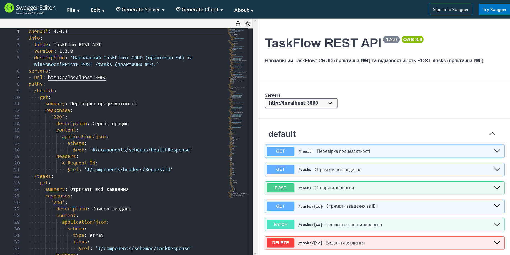
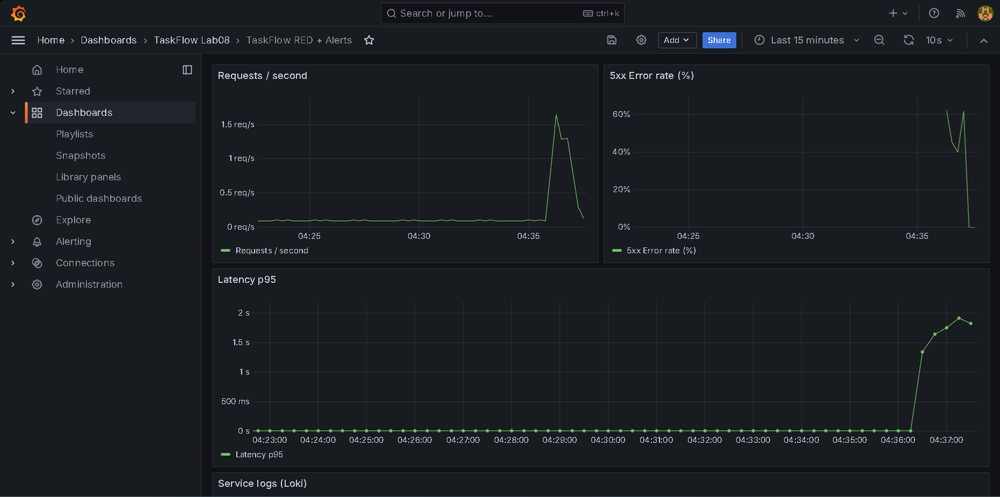
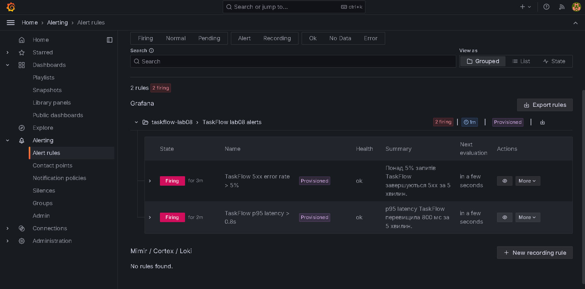

# TaskFlow — система керування завданнями

<!-- CI_BADGE_START -->

<!-- CI_BADGE_END -->

Індивідуальний навчальний проєкт з дисципліни «Вебпрограмування», який послідовно розвивався протягом практичних робіт №1–10 та є основою курсової роботи.

## Можливості

- Створення, перегляд, редагування та видалення завдань.
- REST API на Node.js та Express.
- Локальне збереження даних у SQLite.
- PostgreSQL у контейнерному середовищі.
- Ідемпотентність POST-запитів.
- Rate limiting, retry, exponential backoff, jitter та timeout.
- Кореляція HTTP-запитів через X-Request-Id.
- Degraded mode та демонстрація відмовостійкості.
- Docker Compose та Nginx.
- CI/CD через GitHub Actions і GitHub Container Registry.
- Метрики, логи, розподілене трасування та автоматичні сповіщення.
- Розгортання API та PostgreSQL у Kubernetes.

## Технологічний стек

| Компонент | Технології |
|---|---|
| Frontend | HTML, CSS, JavaScript |
| Backend | Node.js 22, Express |
| Database | SQLite, PostgreSQL |
| Architecture | Modular Monolith, Layered Architecture, DDD |
| API | REST, OpenAPI |
| Containers | Docker, Docker Compose, Nginx |
| CI/CD | GitHub Actions, GHCR, Dependabot |
| Observability | OpenTelemetry, Prometheus, Grafana, Loki, Tempo |
| Orchestration | Kubernetes, Minikube |
| Testing | Node.js Test Runner |

## Архітектура

Застосунок використовує модульний моноліт із розділенням HTTP-рівня, бізнес-логіки, доменних моделей та доступу до даних.

### Docker Compose

    Browser
       |
       v
    Nginx / Frontend
       |
       v
    Express REST API
       |
       v
    PostgreSQL

У локальному режимі Express використовує SQLite та самостійно обслуговує frontend.

### Kubernetes

    Client / Port-forward
            |
            v
      ClusterIP Service
            |
      +-----+-----+
      |           |
    API Pod     API Pod
      |           |
      +-----+-----+
            |
    PostgreSQL Service
            |
    PostgreSQL StatefulSet
            |
           PVC

Конфігурація API передається через ConfigMap, конфіденційні параметри — через Secret. Для контролю стану контейнерів використовуються startup, liveness та readiness probes.

[Архітектурна діаграма Kubernetes](docs/kubernetes/architecture.png)

## Швидкий старт

### Варіант 1. Локальний режим SQLite

Вимоги: Node.js 22.13+ та npm.

    git clone https://github.com/V-Icie/TaskFlow.git
    cd TaskFlow
    npm ci
    npm start

Застосунок доступний за адресою http://localhost:3000.

### Варіант 2. Docker Compose та PostgreSQL

Вимоги: Docker Desktop із Linux Engine.

Для першого запуску створити локальний файл `.env`:

    Copy-Item .env.docker.example .env
    notepad .env

Налаштувати власний пароль бази даних та виконати:

    docker compose up -d --build
    docker compose ps

Адреси:

- Frontend: http://localhost:3000
- Backend: http://localhost:8080
- Health check: http://localhost:8080/health
- PostgreSQL: db:5432 у внутрішній мережі Docker.

Перевірка:

    Invoke-RestMethod http://localhost:8080/health
    Invoke-RestMethod http://localhost:8080/items

    .\scripts\check-docker.ps1

Зупинка:

    docker compose stop

Не використовувати `docker compose down -v`, якщо необхідно зберегти дані PostgreSQL.

[Детальна документація Docker](docs/docker/README.md)

### Варіант 3. Kubernetes

Вимоги: Docker Desktop, Minikube та kubectl.

Маніфести власного сервісу розташовані в `k8s/taskflow/`.

Розгортання включає:

- Namespace taskflow.
- API Deployment.
- ClusterIP Service.
- ConfigMap та Secret.
- PostgreSQL StatefulSet.
- PersistentVolumeClaim.
- Health probes.

Повна процедура збирання образу, створення Secret та розгортання:

[Інструкція Kubernetes](docs/kubernetes/LAB10.md)

Перевірка розгорнутого застосунку:

    kubectl get deployment,rs,statefulset,pods,svc,pvc -n taskflow
    kubectl port-forward -n taskflow svc/taskflow-api 8082:80

В іншому терміналі:

    curl.exe http://localhost:8082/health
    curl.exe http://localhost:8082/items

[Звіт Kubernetes](docs/kubernetes/REPORT.md)

## REST API

| Метод | Endpoint | Призначення |
|---|---|---|
| GET | /health | Перевірка працездатності |
| GET | /items | Отримання демонстраційних записів |
| GET | /tasks | Список завдань |
| GET | /tasks/:id | Отримання завдання |
| POST | /tasks | Створення завдання |
| PATCH | /tasks/:id | Редагування завдання |
| DELETE | /tasks/:id | Видалення завдання |
| GET | /metrics | Метрики Prometheus у режимі Observability |

Для POST /tasks необхідно передавати заголовок Idempotency-Key.

[OpenAPI specification](docs/api/openapi.yaml) · [Swagger documentation](docs/api/README.md)

## Відмовостійкість

Реалізовано:

- Ідемпотентність створення завдань.
- HTTP 409 при повторному використанні ключа з іншим payload.
- HTTP 429 та Retry-After при перевищенні rate limit.
- Автоматичні повтори безпечних запитів.
- Exponential backoff та jitter.
- Timeout через AbortController.
- X-Request-Id для кореляції запитів.
- Degraded mode клієнтського застосунку.

Для локальної демонстрації симульованих помилок:

    $env:DEMO_FAILURES='1'
    npm start

У звичайному режимі демонстраційне внесення помилок вимкнено.

[Матеріали практичної №5](defense/practice-05/DEMO.md)

## Тестування

    npm ci
    npm run lint
    npm test

Результати локальної перевірки від 24.11.2026:

- 29 JavaScript-файлів пройшли синтаксичну перевірку.
- 36 тестів успішно виконано.
- 0 failed.
- 0 skipped.

Перевірено доменні моделі, CRUD, SQLite, PostgreSQL adapter, HTTP middleware, retry, timeout, idempotency, metrics та logging.

## CI/CD

GitHub Actions автоматично виконує:

1. Checkout та налаштування Node.js.
2. Встановлення залежностей через npm ci.
3. Синтаксичну перевірку.
4. Unit та HTTP integration tests.
5. HTTP smoke test.
6. Збірку Docker-образів API та frontend.
7. Збереження артефактів перевірки.

Публікація Docker-образів у GHCR виконується при ручному запуску workflow або push версійного тега.

Реалізовано семантичне тегування v1.0.0, Dependabot, permissions, concurrency та Job Summary.

- [GitHub Actions](https://github.com/V-Icie/TaskFlow/actions)
- [GitHub Packages](https://github.com/V-Icie?tab=packages)
- [Навчальний CI/CD fork](https://github.com/V-Icie/ci-cd-demo)
- [Документація CI/CD](docs/ci/README.md)

## Observability

Для моніторингу TaskFlow використано:

- OpenTelemetry — автоматичне трасування.
- Prometheus — збір HTTP-метрик.
- Tempo — перегляд трейсів.
- Loki — централізовані логи.
- Grafana — дашборди та Alerting.
- Webhook sink — приймання сповіщень.

Налаштовано два правила:

- Частка помилок 5xx понад 5%.
- Затримка p95 понад 800 мс.

Фактично підтверджено спрацювання обох правил, доставку webhook із HTTP 204 та повернення до Normal після завершення тестового навантаження.

[Інструкція Observability](docs/observability/README.md) · [Звіт практичної №8](docs/observability/REPORT.md)

## Практичні роботи

| № | Тема | Документація | Захист |
|---|---|---|---|
| 1 | Клієнт, бекенд, SQLite | [README](README.md) | [Матеріали](defense/practice-01/) |
| 2 | Бізнес-документація та архітектура | [Business document](docs/business_doc.md) | [Матеріали](defense/practice-02/) |
| 3 | Domain-Driven Design | [Domain](docs/domain/) | [Матеріали](defense/practice-03/) |
| 4 | REST API, CRUD, OpenAPI | [API](docs/api/) | [Матеріали](defense/practice-04/) |
| 5 | Resilient HTTP | [Демонстрація](defense/practice-05/DEMO.md) | [Матеріали](defense/practice-05/) |
| 6 | Docker Compose та PostgreSQL | [Docker](docs/docker/README.md) | [Матеріали](defense/practice-06/) |
| 7 | GitHub Actions CI/CD | [CI/CD](docs/ci/README.md) | [Матеріали](defense/practice-07/) |
| 8 | Observability | [Звіт](docs/observability/REPORT.md) | [Матеріали](defense/practice-08/) |
| 9 | Архітектура Kubernetes | [Архітектура](docs/kubernetes/README.md) | [Матеріали](defense/practice-09/) |
| 10 | Kubernetes Deployment | [Звіт](docs/kubernetes/REPORT.md) | [Матеріали](defense/practice-10/) |

## Структура репозиторію

    TaskFlow/
    ├── .github/          GitHub Actions та Dependabot
    ├── defense/          Матеріали захисту практичних №1–10
    ├── docs/             Архітектура, ADR, OpenAPI, звіти
    ├── domain/           Доменні моделі
    ├── frontend/         Docker-конфігурація Nginx
    ├── infrastructure/  Observability-конфігурація
    ├── k8s/              Kubernetes-маніфести
    ├── public/           Клієнтський застосунок
    ├── scripts/          Скрипти перевірки та демонстрації
    ├── src/              Backend
    ├── tests/            Автоматизовані тести
    ├── Dockerfile
    ├── docker-compose.yml
    ├── docker-compose.observability.yml
    ├── package.json
    ├── package-lock.json
    ├── PROGRESS.md
    └── README.md

## Навчальні репозиторії

- [TaskFlow](https://github.com/V-Icie/TaskFlow)
- [CI/CD Demo Fork](https://github.com/V-Icie/ci-cd-demo)
- [Kubernetes Demo Fork](https://github.com/V-Icie/k8s-demo)

## Статус проєкту

Технічну реалізацію практичних робіт №1–10 виконано. Звіти, документацію та фактичні докази виконання збережено в репозиторії.

Проєкт виконується індивідуально. Командні вимоги методички потребують окремого погодження з викладачем. Фіктивні учасники та pull requests не використовуються.

Остаточне оцінювання здійснюється викладачем після захисту.

[Детальний прогрес проєкту](PROGRESS.md)