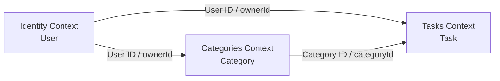

# Контекстна карта TaskFlow

Основне зображення: [context_map.png](context_map.png).

**Інтерпретація стрілок:** у майбутній реалізації Tasks використовуватиме ID власника з Identity та ID категорії з Categories. Це логічні залежності моделей, **не реалізовані зараз мережеві виклики**. Контексти не є окремими мікросервісами. Прототип — частина одного монолітного репозиторію.

**Зв'язок із практичними:** у №1 є лише клієнт, сервер, БД і спрощений Item; у №3 ми формалізували бізнес-модель; у №4 реалізуємо REST API для Task.
