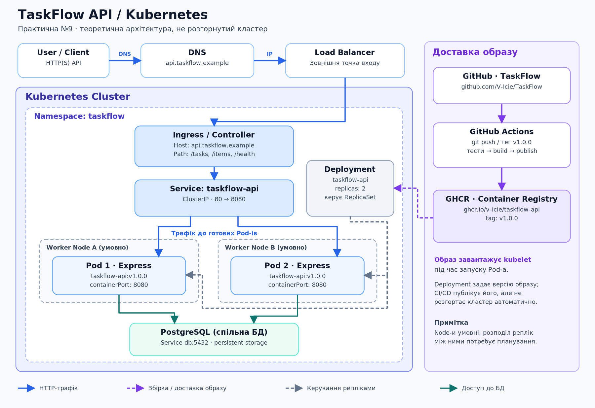

# Практична робота №9. Теоретична схема Kubernetes-додатку

## Призначення сервісу (2 речення)

TaskFlow API — бекенд навчальної вебсистеми керування завданнями, який надає REST API для створення, перегляду, редагування та видалення завдань і зберігає дані в PostgreSQL. Його користувачі — люди, які планують власні завдання через вебінтерфейс або звертаються до API.

## Схема

Редаговані джерела: [draw.io](architecture.drawio) та [SVG](architecture.svg).

## Короткий опис дизайну (5 речень)

У Kubernetes моделюється сервіс TaskFlow API на Node.js та Express у namespace `taskflow`, зі спільною базою PostgreSQL для збереження даних. Клієнт визначає IP-адресу умовного домену `api.taskflow.example` через DNS і надсилає запит на зовнішній Load Balancer, звідки трафік надходить до Ingress. Ingress за Host і шляхом `/tasks`, `/items` або `/health` спрямовує запит у Service `taskflow-api` типу ClusterIP, який передає трафік на готові Pod-и через порт 8080. Deployment задає дві репліки API для базової відмовостійкості, а ReplicaSet підтримує їх потрібну кількість; обидві репліки використовують спільну БД. GitHub зберігає код, GitHub Actions перевіряє його та публікує Docker-образ `ghcr.io/v-icie/taskflow-api:v1.0.0` у GHCR, а Kubernetes використовує заданий у Deployment образ під час запуску Pod-ів.

## Уточнення до моделі

- Схема теоретична: домен `.example`, Load Balancer, namespace та Kubernetes-ресурси не створювалися у цій роботі.
- Моделюється лише API; окремий фронтенд Nginx з практичної №6 не є предметом цієї схеми. Фронтенд або інший HTTP-клієнт може звертатися до API за відповідною конфігурацією.
- DNS повертає IP, а не проксіює HTTP. Ingress описує правила маршрутизації, які реалізує Ingress Controller.
- Service використовує селектор Pod-ів, а не пересилає запити в Deployment. Deployment через ReplicaSet підтримує бажану кількість реплік.
- Node — ресурс кластера, а не namespace; рамки двох Node-ів показують лише умовне розміщення Pod-ів. Для гарантованого рознесення потрібні відповідні правила планування; дві репліки самі по собі не гарантують доступність БД чи кластера.
- GitHub Actions з №7 публікує образ, але автоматичне розгортання в кластер не налаштовано. Під час розгортання kubelet отримує образ із registry; для приватного GHCR потрібна авторизація (наприклад, imagePullSecret).
- PostgreSQL показано як логічну залежність із постійним сховищем, а не як повний дизайн високодоступної бази даних.

## Що здати

1. `architecture.png` (готове зображення схеми; за потреби відкрити `architecture.drawio` у diagrams.net і експортувати або зробити скриншот).
2. Цей Markdown-файл: розділи призначення і короткого опису дизайну.

Окремий розгорнутий звіт, встановлення Minikube та виконання kubectl для №9 не вимагаються. Реальне розгортання — практична №10.
