# Звіт до практичної роботи №8: Observability

**Студент:** _(вписати ПІБ)_  
**Проєкт:** TaskFlow (індивідуальний)  
**Дата перевірки:** 24.11.2026  
**Репозиторій:** https://github.com/V-Icie/TaskFlow  
**Стан:** технічну реалізацію виконано та перевірено.

## 1. Мета роботи

Ознайомлення з принципами спостережуваності програмних систем, використання метрик, логів і розподіленого трасування, інтеграція OpenTelemetry у власний застосунок та налаштування автоматичних сповіщень про проблеми.

## 2. Розгортання інфраструктури

Для виконання роботи використано Docker Compose.

Успішно запущено 10 контейнерів:

- TaskFlow API;
- PostgreSQL;
- Demo App;
- Load Generator;
- OpenTelemetry Collector;
- Prometheus;
- Grafana;
- Loki;
- Tempo;
- TaskFlow Alert Sink.

Перевірка працездатності TaskFlow API через endpoint `/health` повернула `{"status":"ok"}`.

## 3. Рівень 60 балів: навчальний стенд

Запущено навчальний застосунок demo-app та автоматичний генератор HTTP-трафіку.

Перевірено три основні сигнали спостережуваності:

- **Metrics:** частота запитів, частка помилок 5xx, затримка p95.
- **Traces:** тривалість запитів та вкладених операцій.
- **Logs:** структуровані записи про виконання HTTP-запитів.

### RED Dashboard

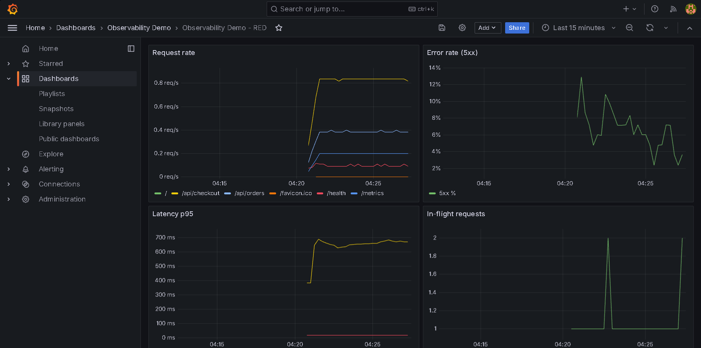

### Tempo

Досліджено запит `GET /api/checkout?flow=slow-db`.

Результати:

- HTTP-статус: 200.
- Загальна тривалість: 446,21 мс.
- Кількість spans: 4.
- Операція db.query orders: 301,4 мс.
- Операція http.call payment-gateway: 142,65 мс.

Основним джерелом затримки цього запиту є операція з базою даних.

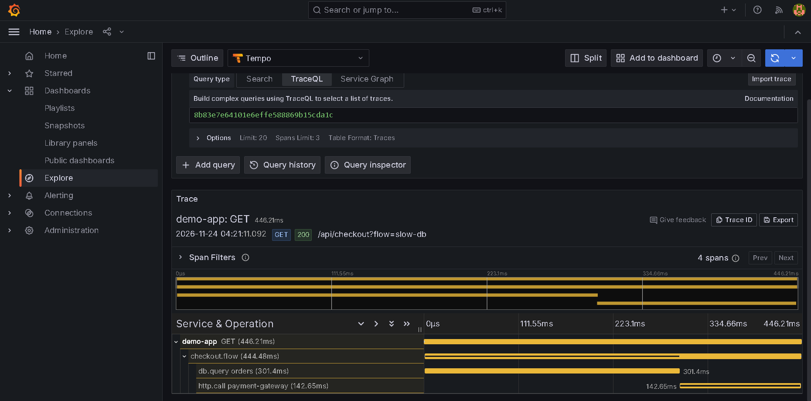

### Loki

Перевірено надходження логів навчального застосунку.

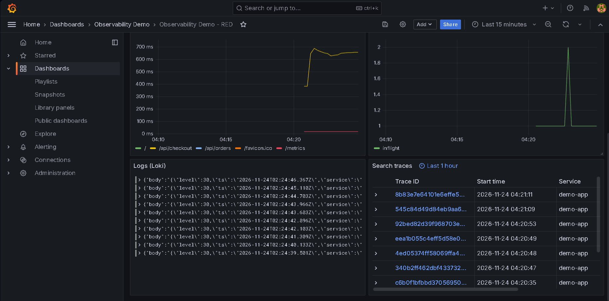

## 4. Рівень 75 балів: власний дашборд

Створено дашборд My Demo RED, конфігурація якого зберігається у файлі `my-demo-red-dashboard.json`.

Дашборд містить чотири панелі:

1. Requests per second.
2. 5xx Error rate.
3. Latency p95.
4. Service logs (Loki).

Часовий діапазон: останні 15 хвилин.

Фактичні результати:

- Інтенсивність запитів: приблизно 1,4 req/s.
- Частка помилок: приблизно 2,5–15%.
- Затримка p95: приблизно 370–670 мс.
- Логи demo-app успішно надходять до Loki.

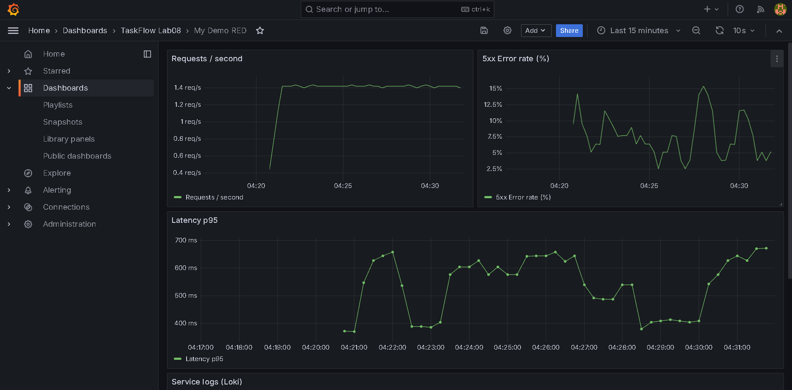

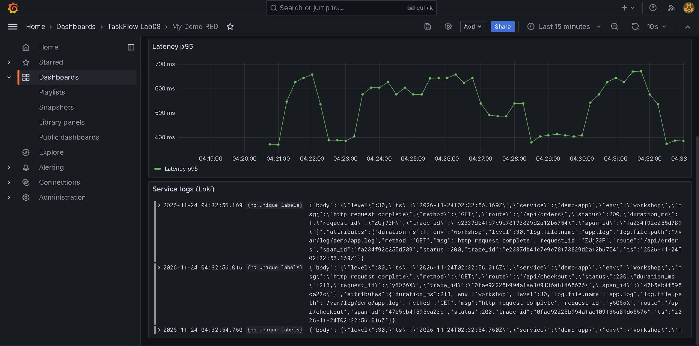

## 5. Рівень 90 балів: інтеграція TaskFlow

Власний сервіс `taskflow-api` інтегровано із системою спостережуваності.

Використані технології:

- OpenTelemetry Node.js Auto-Instrumentation.
- OTLP/HTTP Collector.
- Prometheus для збору метрик через `/metrics`.
- Tempo для збереження та перегляду трейсів.
- Loki для структурованих логів.
- Grafana для візуалізації та сповіщень.

Ресурсні атрибути:

- `service.name=taskflow-api`
- `service.version=1.0.0`

HTTP-метрики та логи містять метод запиту, маршрут, статус відповіді та тривалість виконання. У логах також використовується request_id.

### Тестове навантаження

Використано скрипт `scripts/lab08-traffic.ps1` у трьох режимах:

- normal — звичайні запити;
- errors — 40 запитів із симульованими помилками;
- slow — 12 запитів із симульованими затримками.

Повільні запити успішно повернули HTTP 200. Симульовані помилки повертали HTTP 503.

### TaskFlow RED

Зафіксовано:

- максимальну інтенсивність приблизно 1,65 req/s;
- зростання частки помилок 5xx приблизно до 62%;
- зростання затримки p95 приблизно до 1,9 секунди.

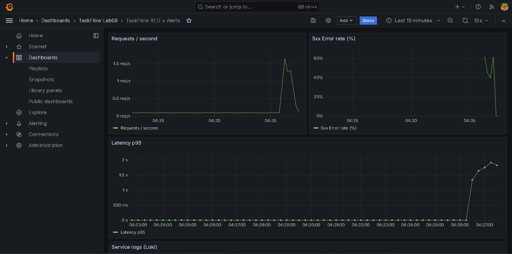

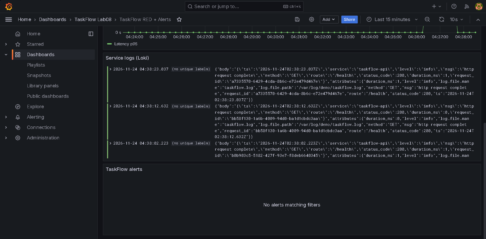

### TaskFlow Tempo

Отримано трейс повільного HTTP-запиту сервісу taskflow-api.

Загальна тривалість становила приблизно 1,1 секунди. Трейс містив чотири spans, зокрема middleware та обробник HTTP-запиту.

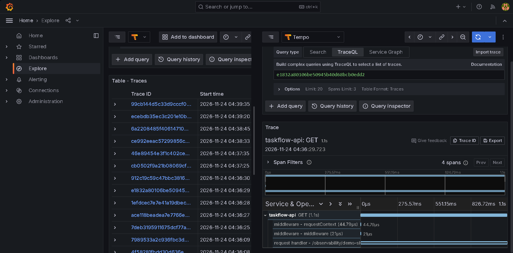

### TaskFlow Loki

Для пошуку логів використано LogQL:

`{service="taskflow-api"}`

Під час перевірки отримано 219 записів.

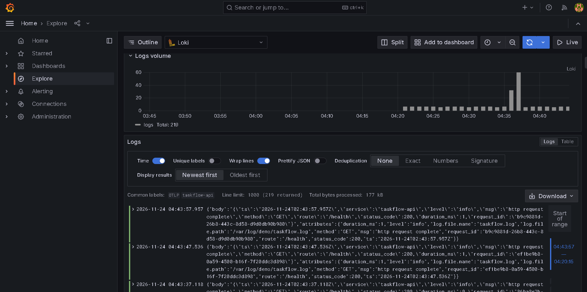

## 6. Рівень 95–100 балів: автоматичні сповіщення

Налаштовано два правила Grafana Alerting з інтервалом оцінювання в одну хвилину.

### Alert 1: Error Rate

Умова: частка HTTP-помилок 5xx перевищує 5% за останні 5 хвилин.

PromQL:

    100 * (
      sum(rate(http_requests_total{job="taskflow-api",status_code=~"5.."}[5m]))
      or vector(0)
    ) / clamp_min(
      sum(rate(http_requests_total{job="taskflow-api"}[5m])),
      0.000001
    )

Умова Grafana: `last(A) > 5`.

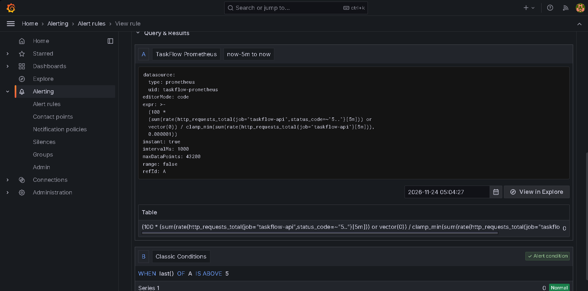

### Alert 2: High Latency

Умова: p95 latency перевищує 800 мс за останні 5 хвилин.

PromQL:

    histogram_quantile(
      0.95,
      sum by (le)(
        rate(http_request_duration_seconds_bucket{job="taskflow-api"}[5m])
      )
    )

Умова Grafana: `last(A) > 0.8`.

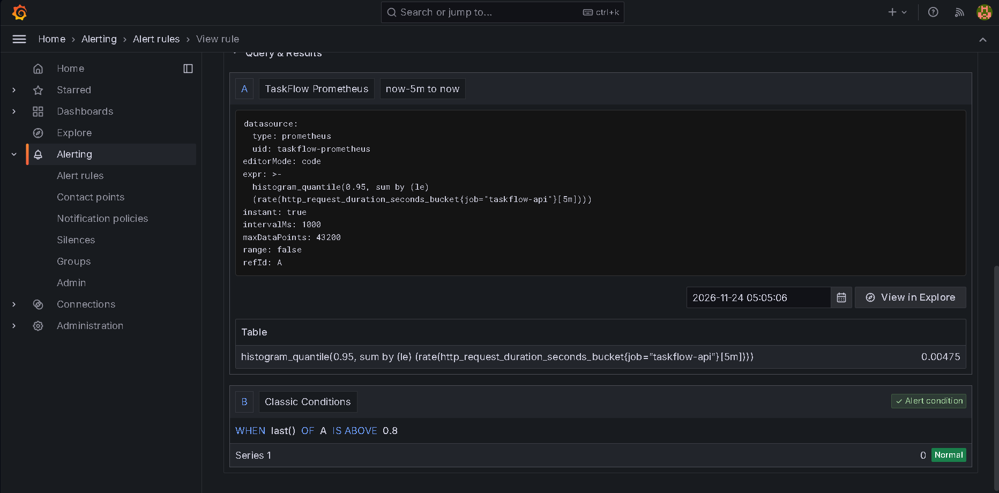

### Перевірка спрацювання

Після генерації тестового навантаження обидва правила перейшли у стан Firing.

Стан працездатності обох правил: Health OK.

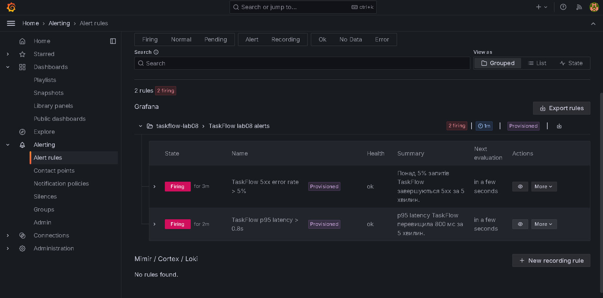

### Alert List

На дашборді TaskFlow RED + Alerts реалізовано панель відображення поточного стану правил.

Після завершення тестового навантаження обидва алерти автоматично повернулися до стану Normal.

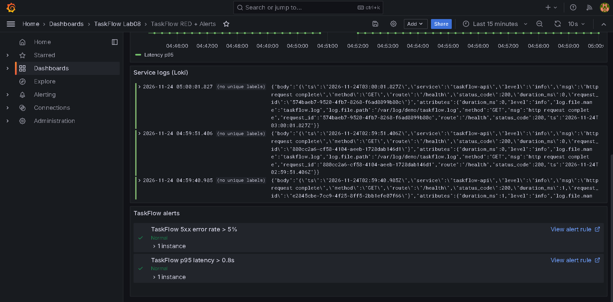

### Webhook

Налаштовано доставку сповіщень за маршрутом:

Grafana Notification Policy → taskflow-webhook → taskflow-alert-sink.

У логах приймача підтверджено:

- отримання Firing для обох правил;
- отримання Resolved для обох правил;
- успішне приймання HTTP POST /alerts із кодом 204.

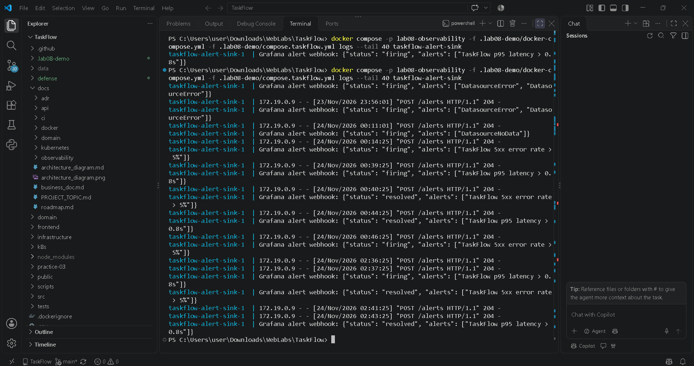

## 7. Усунені проблеми

Під час виконання роботи усунено такі проблеми:

- Некоректне масштабування відсотків на демонстраційному дашборді.
- Відсутність числового значення метрики 5xx за відсутності відповідної серії — використано `or vector(0)`.
- Некоректне посилання Classic Conditions на джерело даних — умови налаштовано на запит A.
- Некоректний фільтр логів — використано label `service`.
- Несумісний параметр `no_data` у конфігурації Alert List — оновлено stateFilter.
- Блокування локального PowerShell-скрипта генерації трафіку.

## 8. Фактичні результати

- [x] Docker Compose успішно запущено.
- [x] Demo RED, Tempo та Loki працюють.
- [x] Власний My Demo RED містить чотири робочі панелі.
- [x] TaskFlow інтегровано з OpenTelemetry.
- [x] Метрики TaskFlow реагують на тестове навантаження.
- [x] Трейси TaskFlow доступні у Tempo.
- [x] Логи TaskFlow доступні у Loki.
- [x] Налаштовано два правила Alerting.
- [x] Підтверджено спрацювання обох правил.
- [x] Підтверджено автоматичне повернення до Normal.
- [x] Підтверджено доставку webhook.
- [x] Зібрано скриншоти фактичного виконання.

## 9. Висновок

У ході практичної роботи реалізовано систему спостережуваності для TaskFlow на основі OpenTelemetry, Prometheus, Grafana, Tempo та Loki.

Створено власні дашборди, перевірено метрики, структуровані логи та розподілене трасування. Налаштовано два правила автоматичного виявлення серверних помилок і деградації швидкодії.

Експериментально підтверджено спрацювання правил, доставку сповіщень через webhook та автоматичне відновлення нормального стану після завершення тестового навантаження.